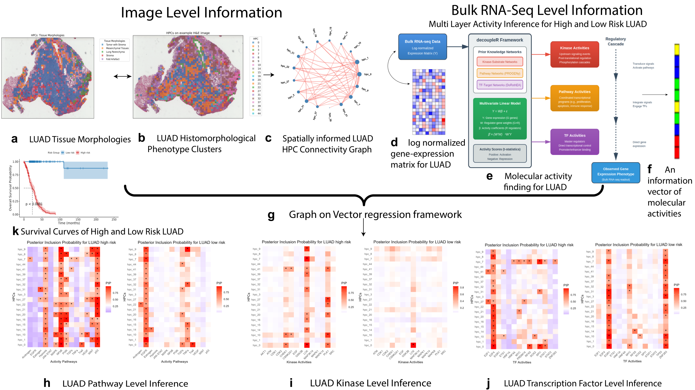

# GOV: Graph-on-Vector regression with latent-space Gaussian processes

Code, analysis scripts and processed outputs for

> Bhadury S. et al. *Graph-on-Vector Association Modeling of Histopathological
> and Transcriptomic Features in Lung Adenocarcinoma.* npj Artificial
> Intelligence (2026). DOI 10.1038/s44387-026-00178-z



**Figure 1. Schematic of the graph-on-vector workflow used to relate
histomorphological phenotype clusters to inferred molecular activities in lung
adenocarcinoma.** **a**, Whole-slide H&E image of a LUAD case with tiles shaded
by coarse tissue morphology. **b**, The same slide with tiles shaded by
histomorphological phenotype cluster (HPC); the 20 survival-associated HPCs are
used throughout. **c**, The participant-specific spatial HPC graph derived from
panel b (nodes are HPCs, edges are retained G-cross spatial relations).
**d**, Log-normalised bulk RNA-seq expression matrix. **e**, decoupleR activity
inference from the expression matrix and three prior-knowledge networks
(kinase-substrate, PROGENy pathway, DoRothEA transcription-factor targets).
**f**, The resulting per-participant activity vector. **g**, The graph-on-vector
regression framework, which takes the graph of panel c and the activity vector
of panel f and returns node-level posterior inclusion probabilities (PIPs).
**h**-**j**, PIP heat maps for the pathway, kinase and transcription-factor
layers (high-risk group left, low-risk group right; a dot marks PIP > 0.5).
**k**, Kaplan-Meier overall-survival curves of the two survival-rank-defined
groups. The schematic illustrates the workflow; the quantitative post-burn-in
PIPs are in `results/audit/post_burnin_pips.csv` and Figure 2 of the paper.

The repository has three parts.

| Part | Where | What it is |
|---|---|---|
| R package `GOV` | `R/`, `man/`, `DESCRIPTION`, `NAMESPACE` | The two model functions: `EM_toU()` (latent-space network model fitted by EM) and `lsGPR_VS()` (Gaussian process regression on the latent positions with node-level spike-and-slab selection). |
| Analysis pipeline | `analysis/` | The scripts that produced the TCGA-LUAD results in the paper, in the order they were run, plus the audit scripts that regenerate every table and Figures 2 and 3. See `analysis/README.md`. |
| Processed outputs | `results/` | Post-burn-in posterior inclusion probabilities, threshold sensitivity, held-out prediction metrics, MCMC diagnostics, and the NFkB proposal-tuned refit summaries. See `results/README.md`. |

`ENVIRONMENT.md` records the R and package versions, including the decoupleR
and OmnipathR releases used to infer the pathway, kinase and transcription-factor
activities.

`deprecated_july2026_fdr/` holds an earlier set of files that are **not** part of
the published analysis and must not be cited; see the README inside that folder.

## Installing the package

```r
# install.packages("remotes")
remotes::install_github("sagnikbhadury/GOV")
```

## Using the package

```r
library(GOV)

# Stage 1: latent node positions and a density intercept from one adjacency matrix
fit_latent <- EM_toU(adj, d = 3, u1 = 0.5, sig.a = 2, sig.u = 2, tol = 1e-10, maxiter = 3)

# Stage 2: regress a scalar response on the latent representation,
# selecting which nodes drive the kernel
fit <- lsGPR_VS(a = a_train, a.te = a_test,
                U = U_train_list, U.te = U_test_list,
                Y = y_train,
                burn = 500, nrun = 1000)

pip <- rowMeans(fit$GAMMA[, (fit$burn + 1):fit$nrun])   # one PIP per node
```

The arguments shown are the ones used for the paper (see
`analysis/02_graph_construction/` and `analysis/03_graph_on_vector_fits/`).
The function defaults (`burn = 5000`, `nrun = 10000`) were not used for the
published fits. `?EM_toU` and `?lsGPR_VS` document every argument.

## Data

All raw data are public TCGA-LUAD resources: whole-slide images, clinical data
and bulk RNA-seq from the NCI Genomic Data Commons
(https://portal.gdc.cancer.gov/, project TCGA-LUAD), and the histomorphological
phenotype cluster (HPC) definitions and per-tile assignments from the published
Histomorphological Phenotype Learning resource
(https://github.com/AdalbertoCq/Histomorphological-Phenotype-Learning).

The per-slide HPC adjacency matrices derived from the HPL tile assignments are
intermediate files and are not distributed here. The scripts that consume them
(`analysis/02_graph_construction/run_on_files_obtain_U_and_a.R`) document their
format: one CSV per slide, a 20 x 20 matrix over the survival-associated HPCs,
first column holding row names.

## Reproducing the paper's tables and figures

The 84 saved model objects (one per risk group x layer x activity) are not
distributed because of their size; the audit scripts in `analysis/04_audit/`
read them from a local `luad/` folder and write every CSV in `results/audit/`,
the supplementary heatmaps, and Figures 2 and 3. Their outputs are the CSVs in
`results/`, so every number in the paper can be checked against those files
without rerunning MCMC.

## Licence

MIT (see `LICENSE`).

## Contact

Sagnik Bhadury (sagnik.bhadury@gmail.com)
